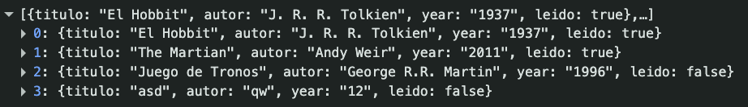
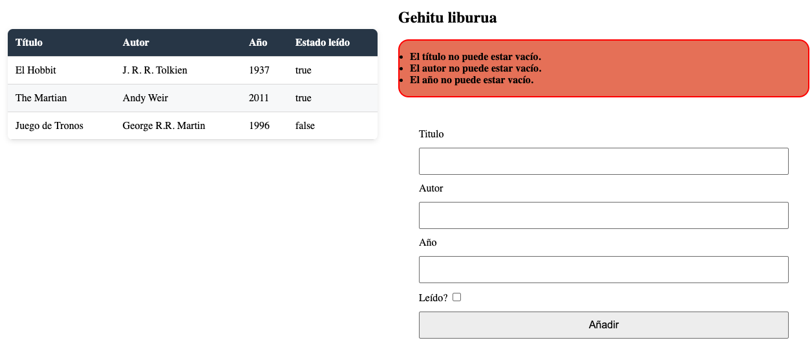

# Ariketa 04

3 zatitan banatzen da ariketa. Zati bakoitzak ondo badago puntuatuko da:

- **Webgunea kargatzerakoan**: “*localStorage*”-tik klabe **“azterketa4”** dauden liburuen array-a taulan erakutsi (**0,5 puntu**) . Adibide bezala:

- Formularioaren balidaketa: Titulo, autor eta year bete behar dira liburua gehitzeko. Zerbait faltatzen bada formularioa ez da bidaliko eta errore lista bat agertuko da. (**1,25 puntu**)
- Formularioa bidaltzerakoan: (**1,25 puntu**)
  - “*localStorage*”-ko **“azterketa4”** klabean gehitu liburu berria.
  - taulan agertu behar dira liburu guztiak

