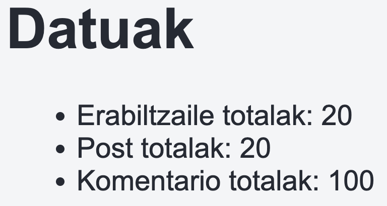

# Ariketa 05

API batean dauden informazio “guztia” lortu behar duzu. Zenbat erabiltzaile (**/users**), posts (**/posts**), eta comments (**/comments**) lortu eta zenbatu beharko duzu. (**0,5 puntu**)

- HTML-n jarri baino lehen itxaron beharko duzu datu guztiak lortu harte (eskaerak amaitu arte) eta ondoren HTMLn irudikatu: (**0,5 puntu**)

