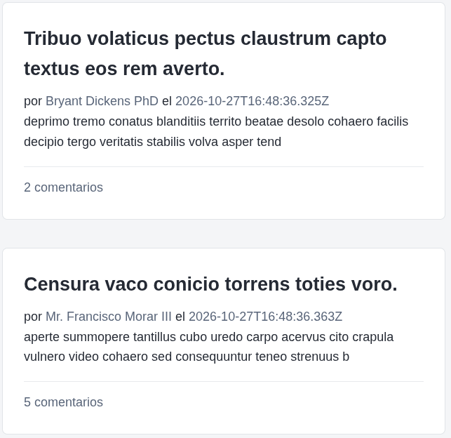

# Ariketa 06

API baten informazioa lortu behar duzu, blog baten Post-ak lortzeko (**/posts**), zenbat comments dauzkan (**/posts/:id/comments**) eta HTML-n jarri. (**1,5 puntu**)

- Bakarrik agertu behar dira “*published*” dauden Post-ak (**0,5 puntu**)
- HTML-ren hasieran daukazu adibide bat itzura eta CSS klaseak jakiteko nola jarri behar diren.

